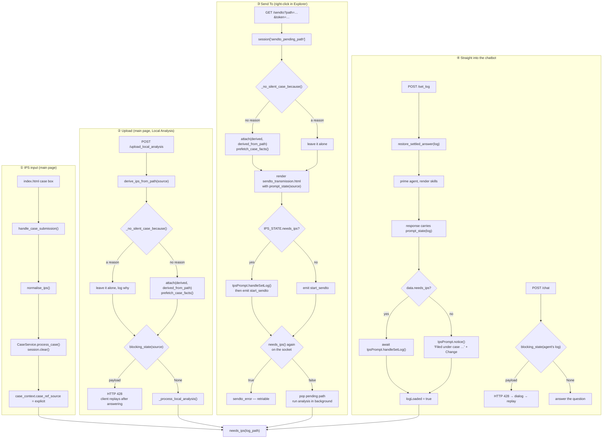
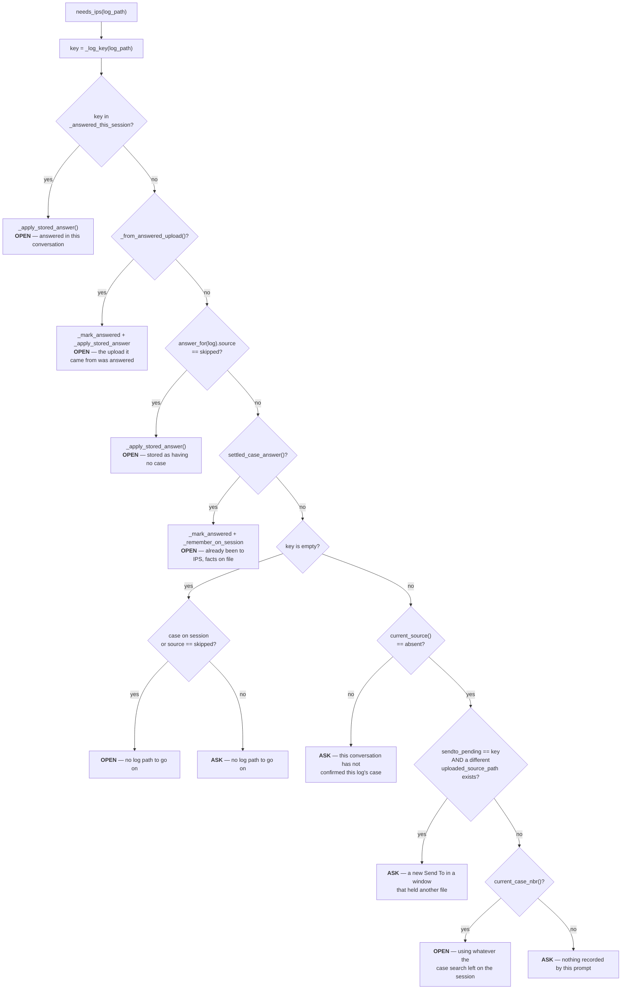
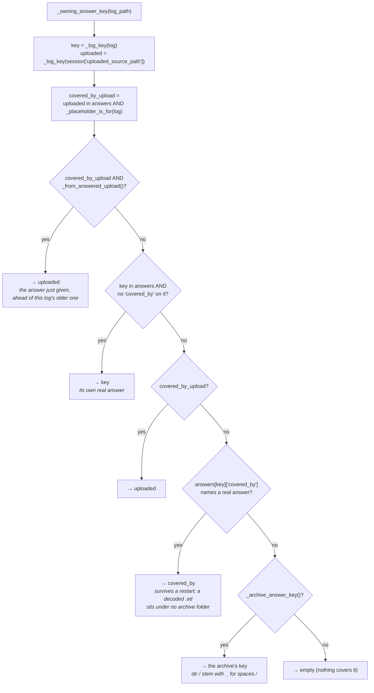
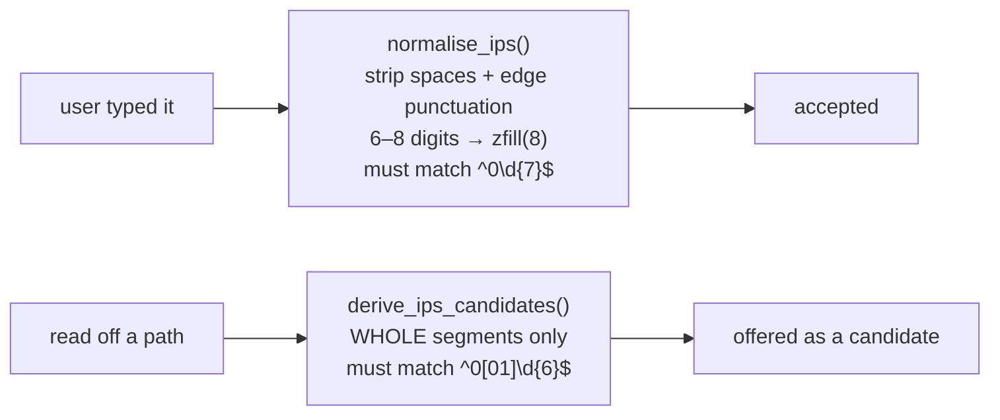
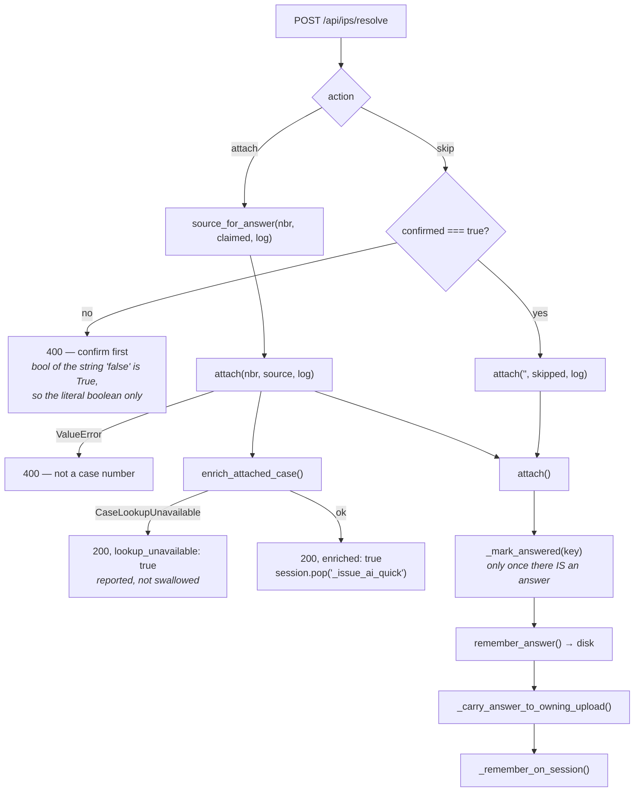
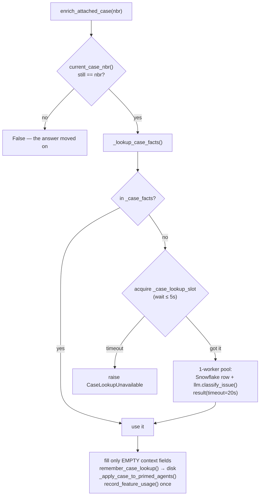

# How a log gets its IPS case number

Analysing a log and then chatting about it is work that is billed against a
case. A session that never names a case cannot be traced back to one
afterwards, so every entry point has to arrive at one of three answers before
the expensive work starts:

| Answer | `case_ref_source` | Means |
|---|---|---|
| A case number the user typed | `explicit` | Somebody asserted it |
| A case number read off the path | `derived_from_path` | Inferred, nobody asked |
| "This log has no case" | `skipped` | A deliberate statement, not a dismissal |
| *(nothing recorded)* | `absent` | The gate has not been satisfied |

`absent` is the state this whole feature exists to keep out of the warehouse.

Everything below is one service — [`services/check_ips_service.py`](services/check_ips_service.py) —
plus the four places that call into it.

---

## 1. The four ways in

The question is asked **where the work starts**, not where the chatbot opens.
That is the single rule the rest of the design follows from, and the reason
the same file can be asked about under one path and never asked about under
another.



Two details that are easy to misread:

- **Send To is checked twice on purpose.** The page asks before it emits
  `start_sendto`, but Socket.IO is not covered by the 428 interception that
  guards every HTTP entry point, so `needs_ips()` is repeated inside the
  handler. It is the one refusal the user can act on and retry, which is why
  `sendto_pending_path` is deliberately *not* popped on that branch.
- **`/set_log` must be awaited.** `tryAutoAnalyzeOnLoad()` does nothing but
  wait for `logLoaded`, then fetches `/get_issue_context` and pre-fills the
  input box. Setting `logLoaded = true` before the dialog is answered released
  it while the dialog was still on screen: it fetched with no case attached,
  pre-filled from a description that did not exist yet, and nothing re-read the
  box when the answer arrived — "the lookup found the case and nothing reached
  the input box".

---

## 2. The gate: `needs_ips(log_path)`

One function decides whether the modal blocks. The branches are ordered, and
every one of them exists because of a specific way the previous ordering was
wrong. `_gate()` prints one line per decision, because every bug report about
this feature is of the form "it asked again" or "it did not ask".



### Why each branch is there

| Branch | Without it |
|---|---|
| answered in this conversation | A slow request that started before the answer writes the session back over the top of it, and the dialog reappears |
| the upload was answered | The question is asked about the `.zip` / `.etl` that was sent, then again about the `.log` decoded out of it — twice inside one piece of work |
| stored as having no case | A log somebody confirmed has no case is nagged about forever, across restarts |
| already been to IPS | The chatbot already names the case on screen and offers the same way to change it, so the dialog only repeats itself |
| new Send To in a used window | A case found by an earlier case search would silently adopt a brand-new file that merely arrived in the same browser |
| `absent` + a case on the session | A case typed into the case search belongs to whatever the user is working on, so it counts for any log they open |

A remembered **case number** is deliberately *not* reapplied by the
`skipped` branch: each new conversation confirms a number again, so one file's
case is never inherited by the next. A remembered **skip** is, because the user
answered a question about a file and that does not stop being true.

---

## 3. Which stored answer covers a log

The question is asked about the file that was *sent*. The chatbot then opens a
file extracted or decoded from it, under a path nobody was asked about. So
"what is the answer for this log" is a lookup, not a dictionary hit.



`_placeholder_is_for(log)` is the test for "this log belongs to the session's
local run": the uploaded file itself, something decoded from it
(`x.etl` → `x.etl.003.log`), or a file inside its extraction folder. Anything
else is left over from an earlier upload and describes a different log.

### What lives in the store

`<avatarfiles_dir>/app_state/ips_answers.json`, written atomically under
`_answer_lock`, trimmed to the 500 most recent by `at`.

| Key shape | Holds | Why it is separate |
|---|---|---|
| `<normalised log path>` | `case_nbr`, `source`, `at` | The answer, filed against whatever was *asked about* |
| `<normalised log path>` with `covered_by` | `case_facts` only | **Not an answer.** Where one log out of a shared archive keeps its own `description`, `attachment_time`, `issue_time(s)` — two logs from one archive are two captures, and sharing the record made saving the second overwrite the first |
| `case:<nnnnnnnn>` | `lookup`, `organized` | Belongs to the **case**, not to any capture of it: what IPS said, and the LLM pre-pass over that. Namespaced so it can never collide with a log key |

Path keys are normalised by `_log_key()` so one file cannot have two keys:
the `\\?\` extended-length prefix is stripped, 8.3 short names (`INTELA~1`)
are expanded, then `normcase(abspath(...))`. Each of those three was a real
bug where a confirmed answer was invisible to the code that looked it up.

---

## 4. What a case number is

[`utils/check_ips_utils.py`](utils/check_ips_utils.py) holds the single
definition. Typing and guessing are held to **different** standards, which is
the same distinction `case_ref_source` draws downstream:



- A **typed** number only has to be eight digits starting with a zero.
  Refusing a real case mid-analysis is the expensive failure, so a zero-led
  date like `05122024` is accepted — it cannot be told from a case number, and
  `01012497` is a real one.
- A **guessed** number must match the narrower `00`/`01` form, because a guess
  should not be the thing that invents a case. Whole segments only: a folder
  named `20260923_01010628_retry` is a name containing digits, not a case
  folder.
- A `YYYYMMDD` date never starts with a zero, so it is rejected everywhere.
- `local_upload_*` / `local_bsod_*` are **synthetic** placeholders
  (`is_synthetic_case_nbr`) — a name for one run, not a case number. They
  attribute nothing, and the results page looks its extraction index up by
  them, which is why they survive a skip.

### Candidate priority

`candidates_for()` builds the offer list by inserting at the front, so the
final order is:

1. the answer remembered for this exact log
2. the case currently on the session (only if `_session_answer_is_about()`)
3. the answer given for the archive this log came out of
4. case numbers appearing as whole path segments, nearest the file first

`candidate_sources()` reports where each one came from, because the client used
to treat every candidate as path evidence — a number the user had typed in an
earlier conversation came back as `derived_from_path`, and a path guess picked
over a remembered answer was recorded as `explicit`. The server decides the
final source in `source_for_answer()` and never trusts the client's claim.

---

## 5. Recording the answer



`_remember_on_session()` is where a case *change* has to be cleaned up after,
and it is the part that has been subtly wrong most often:

- A different real case → rebuild the `CaseContext` from scratch, keeping only
  what describes the **log** (`wifi_or_bt`, `files_coexist`). Keeping the old
  subject and description meant the next analysis discussed the new case
  number using the old case's summary.
- `_forget_case_on_agents()` → `/set_log` primes the agent from the session
  *before* the prompt is answered, so clearing the session alone left the agent
  discussing the new case from the old case's notes. It also drops
  `feedback_conversation_id`, because resuming a thread by id re-adopts the
  detached agent with the old case's log and history intact.
- `forget_case_derived_session_keys()` → the five keys listed in
  `CASE_DERIVED_SESSION_KEYS`, which is named precisely because two callers
  far apart need the same list and a second hand-written copy is how one of
  them ends up a key behind.
- An agent primed with no case at all gets the number written into its live
  `issue_context`, which is read on every answer — so no re-priming, which
  would reset the conversation.
- A synthetic placeholder is a *rename*, so `download_results` is moved to the
  new key; otherwise the results page has nothing to show.

### Looking the case up

A number typed into the case search is looked up and classified. A number
typed into *this* prompt used to be recorded as a bare number, so a perfectly
good case still showed "Unclassified" and the agent analysed without the
customer's description.



Three things this shape is protecting:

- **`CaseLookupUnavailable` is raised, not returned.** A case with nothing to
  add is a finished answer; a lookup that never ran is worth trying again. A
  caller that only checks for a falsy result cannot tell them apart, and the
  user should not be told the case was enriched when it was not.
- **The slot is waited for, not walked away from.** Refusing instantly meant a
  case attached while any other lookup was in flight came back with its number
  and nothing else — and two Send To runs in a row are enough to overlap,
  which is the normal way to use it. The wait is shorter than the lookup's own
  timeout, so queueing cannot make the answer slower than a fresh lookup.
- **The usage claim belongs to the first caller that uses the facts**, not to
  whoever ran the lookup. A prefetch thread has no workflow to bill and
  discards the result, so marking the lookup left the classification unpaid-for.

`prefetch_case_facts()` warms this in a daemon thread when a case is attached
without anybody being asked — the analysis that follows takes far longer than
the lookup, so the wait is free and the chatbot's first read finds the answer
made. `enrich_attached_case_if_needed()` covers the other direction: a number
taken from the path was attached quietly, so nothing enriched it and the
conversation opened knowing the case and none of what it says.

---

## 6. New conversation, same browser

`start_new_session()` runs on every chatbot reset
([`services/chatbot/shared_routes.py`](services/chatbot/shared_routes.py),
and the NW and Wi-Fi/BT reset routes). It clears
`_answered_this_session` and `_ips_answered_upload_key`, then sets
`case_ref_source` back to `absent` so the next log confirms its case again —
and rebuilds the `CaseContext` down to just the log's own fields, because
blanking only the number left the subject, description and attachments behind
for the next log's agent to be primed from.

A synthetic `local_upload_*` placeholder is the exception: it is this run's own
name, so only the answer is reset.

---

## 7. Function reference

**[`services/check_ips_service.py`](services/check_ips_service.py)** — the whole decision

| Function | Answers |
|---|---|
| `needs_ips(log)` | Should the modal block? Prints one `[ips] gate` line per decision |
| `prompt_state(log)` | Everything the client needs: `needs_ips`, candidates, per-candidate sources, `case_nbr`, `log_path` |
| `blocking_state(log=None)` | The 428 payload, or `None`. Falls back to `chatbot_log_path` → `_last_prompted_log` → `last_analyzed_log_path` |
| `attach(nbr, source, log)` | Record an answer. Raises `ValueError` rather than storing an untraceable number |
| `source_for_answer(nbr, claimed, log)` | The source to record — decided here, never trusted from the client |
| `candidates_for(log)` / `candidate_sources(log)` | What to offer, and where each offer came from |
| `_owning_answer_key(log)` | Which stored answer covers this log |
| `_placeholder_is_for(log)` | Is the session's local run *this* log's run? |
| `_archive_answer_key(log)` | The archive this log was extracted from, if any |
| `answer_for(log)` / `remember_answer(...)` | Read / write one answer on disk |
| `settled_case_answer(log)` / `restore_settled_answer(log)` | Has this log been to IPS and back? Put that case back before priming |
| `remembered_case_facts(log, nbr)` / `remember_case_facts(...)` | This capture's description and times |
| `remembered_case_lookup(nbr)` / `remember_case_lookup(...)` | What IPS said about the case |
| `remembered_organized(...)` / `remember_organized(...)` | The LLM pre-pass, keyed on what it ran over |
| `enrich_attached_case(nbr)` | Fill the session from IPS + classify. Raises `CaseLookupUnavailable` |
| `enrich_attached_case_if_needed()` | Same, for a case attached quietly from a path |
| `prefetch_case_facts(nbr)` | Warm the lookup in the background |
| `start_new_session()` | A new conversation confirms its case again |
| `current_case_nbr()` / `current_source()` | What is on the session now |
| `attributed_source()` | How it was *really* obtained — for telemetry. Not the same question as `current_source()`; collapsing them broke attribution on the way to the warehouse |
| `case_wireless_domain(ctx)` | Which radio the **case** is about, from the IPS subcategory |
| `forget_case_derived_session_keys()` | Drop the five `CASE_DERIVED_SESSION_KEYS` |

**[`utils/check_ips_utils.py`](utils/check_ips_utils.py)** — what a case number is

| Function | Answers |
|---|---|
| `normalise_ips(raw)` | Canonical 8-digit form of a **typed** number, or `""` |
| `derive_ips_candidates(path)` | Case numbers that are whole path segments, nearest the file first |
| `derive_ips_from_path(path)` | The best of those, or `""` |
| `is_case_folder_segment(seg)` | May this one segment be read as a case folder unprompted? |
| `is_synthetic_case_nbr(nbr)` | Is this a `local_upload_*` / `local_bsod_*` placeholder? |

**Entry points**

| Location | Role |
|---|---|
| [`blueprints/check_ips/check_ips_routes.py`](blueprints/check_ips/check_ips_routes.py) | `GET /api/ips/candidates`, `POST /api/ips/resolve` |
| [`static/js/check_ips_prompt.js`](static/js/check_ips_prompt.js) | The dialog. Wraps `window.fetch` to catch any 428 with `ips_required` and replay it; `IpsPrompt.handleSetLog()`; `notice()` for a quiet attach |
| [`blueprints/log_parser/log_parser_routes.py`](blueprints/log_parser/log_parser_routes.py) | Upload (`_no_silent_case_because`, 428) and Send To (`/sendto`, `start_sendto`); `_resolve_local_case`, `_local_case_context`, `carry_upload_answer` |
| [`blueprints/main/main_routes.py`](blueprints/main/main_routes.py) | The case box — `handle_case_submission()`, the only path that starts from a number |
| [`blueprints/chatbot/chatbot_routes.py`](blueprints/chatbot/chatbot_routes.py) | `/set_log` (carries `prompt_state`, calls `restore_settled_answer`), `/chat` (428 on the **agent's** log, not the session's) |
| [`blueprints/nw_analysis/nw_analysis_routes.py`](blueprints/nw_analysis/nw_analysis_routes.py) | The same two checks for NW |
| [`static/chatbot/js/strategies/chat-runtime-base.js`](static/chatbot/js/strategies/chat-runtime-base.js) | `setLog()` — **awaits** the dialog before setting `logLoaded` |
| [`templates/sendto_transmission.html`](templates/sendto_transmission.html) | Asks before emitting `start_sendto` |

---

## Reading the log

Every decision prints one line, all prefixed `[ips]`. The useful ones:

```
[ips] gate ASK: this conversation has not confirmed this log's case | case=- source=absent | C:\...\x.log
[ips] gate OPEN: the upload it came from was answered (C:\...\bundle.zip) | ...
[ips] told the browser: needs_ips=False case=01010628 candidates=['01010628']
[ips] <log> is covered by the answer for the archive it was extracted from: <zip>
[ips] recall hit for 01010628 from <key>: description=842 chars, issue_time=…
[ips] recorded: 01010628 (explicit) for C:\...\x.log
[ips] not taking the case from the folder name: this window is already on 01010628 | …
```

"It asked again" and "it did not ask" are both answered by the single
`gate ASK:` / `gate OPEN:` line and its reason.
