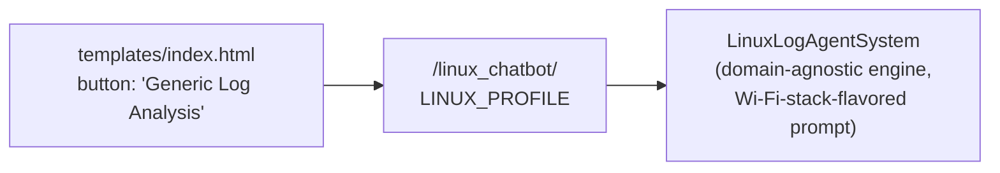
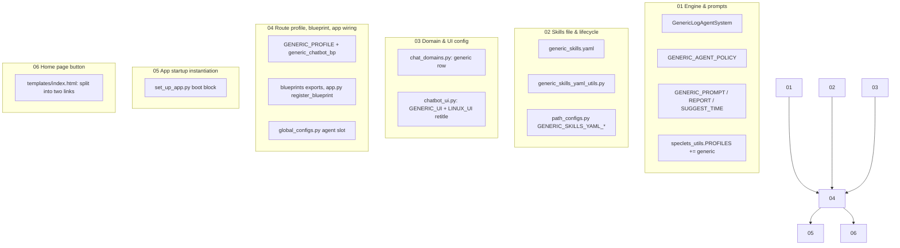

# Workpad: split "Generic Log Analysis" into a real Linux profile and a real Generic profile

Status: shipped. Proposed on 2026-11-13, shipped on 2026-11-13. Progress is tracked in
[PROGRESS.md](PROGRESS.md). Each sub-task below was developed and validated on its own before
dependents started. All seven sub-tasks (including 07, automated unit tests) are done.

Parent: none.

## Task (from the owner)

"i would like duplicate another one to be a generic log chatbot while the old one to be a linux
log chatbot in the button in the main html" — i.e. split today's single `/linux_chatbot/` feature
(home page button labeled "Generic Log Analysis") into two separately-clickable chatbots: one
honestly labeled "Linux", and a new duplicate that is actually domain-agnostic, labeled "Generic".

## Background

The home page (`templates/index.html:1456-1459`) links four chatbot shortcuts. The fourth,
`/linux_chatbot/`, is backed by `LinuxLogAgentSystem` (`services/chatbot/engine/linux.py:42`) and
its route profile `LINUX_PROFILE` (`blueprints/chatbot/chatbot_routes.py:2157`). Its *engine*
behavior is already domain-agnostic — empty driver markers, `SCOPE_FULL_LOG_WHEN_EMPTY = True`
(`engine/linux.py:59-61`) — but its *content* is not:

- Its default system prompt, `LINUX_PROMPT` (`services/chatbot/engine/speclet_defaults.py:155`),
  opens with "You are an Elite **Linux Wi-Fi Diagnostic Engineer**... iwlwifi / mac80211 /
  cfg80211... wpa_supplicant / NetworkManager" and its report skeleton
  (`LINUX_REPORT`, same file, line 185) asks for "kernel / linux-firmware version" and
  "iwlwifi or NetworkManager settings".
- Its AI issue-time focus, `LINUX_WIFI_FOCUS` (`utils/issue_time_ai.py:224`), biases suggestions
  toward Wi-Fi-stack keywords (`iwlwifi|wl[a-z0-9]+:|cfg80211|mac80211|wpa_supplicant|...`).
- Its skill set, `utils/linux_skills.yaml`, holds one deliberately-generic no-op filter skill
  (`Whole_Log_Unfiltered`) — this part already matches the "generic" label.
- `configs/chat_domains.py:93` documents the mismatch itself: "`linux` is the 'Generic Log
  Analysis Agent' -- it is pointed at whatever log the user has" is the stated *intent*, but the
  prompt text doesn't live up to the name.

The codebase has an established, documented recipe for adding a profile — followed twice already
(Wi-Fi → BT → Linux) — specifically so a new profile needs no new handler code, only new data:
`AgentCapabilityPolicy` (engine behavior switches), an `AgentRouteProfile` (HTTP-layer identity),
a UI config dict, a chat-domain row, a skills YAML + lifecycle module, and app-startup wiring. See
`blueprints/chatbot/chatbot_routes.py:1-52` (module docstring) for the stated design intent.

## Cause / Goal

One feature is wearing two names today. The goal is two independent features:

1. **Linux Log Chatbot** — keep `linux_chatbot`'s current behavior exactly as-is; only its
   display title changes (`"Generic Log Analysis Agent"` → `"Linux Log Chatbot"`), and its home
   page link label changes to match.
2. **Generic Log Chatbot** — a new 5th profile (`generic_chatbot`), built from first principles
   as a sibling of the Linux profile, not a copy of it: both independently subclass the one shared
   engine (`WifiLogAgentSystem`), and each policy/flag value is justified on its own terms (see
   `01_engine_and_prompts.md`'s "Note" and per-field reasoning) rather than inherited by analogy
   to Linux. It gets its own domain-agnostic default prompt/report/issue-time text, its own skills
   file, agent slot, chat-history domain, and home page button. Where independent reasoning lands
   on the same value Linux happens to use (e.g. disabling the two Wi-Fi/BT-firmware-specific
   tools — the only two that exist in the whole 4-tool registry), that is called out explicitly as
   coincidence of a shared constraint, not inheritance; one genuine behavioral difference is
   `reset_conversation_on_prepare=True` (Linux/BT use `False`, which the code itself flags as
   likely drift — see `04_route_profile_and_wiring.md`).

## Recommendation

Build bottom-up, the same direction the Wi-Fi→BT→Linux precedent was built in: engine-level
pieces first (new agent class, policy, prompts, skills lifecycle — all independently importable
and independently testable), then the route/blueprint layer that wires them into the app, then
the app-startup instantiation, then the home page UI. Each layer's validation gate is "does the
app still import/start cleanly" — `create_chatbot_blueprint`'s `handler_map()`
(`services/chatbot/factory.py`) already fails fast at import time if a profile is missing a
required handler, so a clean app start is strong evidence the wiring is correct before any manual
UI check.

## Workflow

Current state — one profile serving two names:

Target state and sub-task order:

## Sub-tasks

| # | Sub-task | Workpad |
|---|---|---|
| 01 | Engine class, capability policy, default prompts | [01_engine_and_prompts.md](01_engine_and_prompts.md) |
| 02 | Skills file and YAML lifecycle module | [02_skills_yaml_lifecycle.md](02_skills_yaml_lifecycle.md) |
| 03 | Chat domain row and UI config | [03_domain_and_ui_config.md](03_domain_and_ui_config.md) |
| 04 | Route profile, blueprint, and app registration | [04_route_profile_and_wiring.md](04_route_profile_and_wiring.md) |
| 05 | App-startup agent instantiation | [05_app_startup_instantiation.md](05_app_startup_instantiation.md) |
| 06 | Home page button split | [06_home_page_button.md](06_home_page_button.md) |
| 07 | Automated unit tests for the generic_chatbot blueprint | [07_unit_tests.md](07_unit_tests.md) |

## Rules

- Generic's prompt, skills, tool policy, and behavior flags must each be justified independently
  from the nature of "a log of unknown domain" — never written as "same as Linux, since it's
  similar." Where the reasoning happens to land on a value Linux also uses, say so explicitly and
  why (shared constraint, not borrowed decision); do not silently copy a Linux value without
  re-deriving it. See `01_engine_and_prompts.md` for the worked example of this at the engine
  layer.
- Do not change `LinuxLogAgentSystem`, `LINUX_PROFILE`, `LINUX_AGENT_POLICY`, `LINUX_PROMPT`,
  `LINUX_WIFI_FOCUS`, or any existing Linux-prefixed file's *behavior* — only its displayed title
  and the home page label change. Every other Linux edit in this workpad is additive (new
  `generic`-prefixed siblings), never a rename-in-place of shared code.
- `AgentCapabilityPolicy` and `AgentRouteProfile` are both `@dataclass(frozen=True)`
  (`services/chatbot/engine/system.py:144`, `blueprints/chatbot/chatbot_routes.py:164`) — new
  profiles are new instances, never mutations of `WIFI_AGENT_POLICY`/`LINUX_AGENT_POLICY` etc.
- `create_chatbot_blueprint`'s `handler_map()` validates at **import time** that a profile
  supplies every handler its declared UI capabilities require (raises `RuntimeError` otherwise) —
  treat "the app imports/starts without error" as a real signal, not a formality, after sub-task
  04.
- The shared `skills_config/cloud` and `skills_config/user` directories
  (`utils/skills_yaml_utils.py`) already hold Wi-Fi/BT/Linux skill files side by side,
  distinguished only by filename prefix — the new `generic_skills_` prefix must not collide with
  or prune those existing files (see the prune-loop guard in
  `utils/linux_skills_yaml_utils.py:250-259`, which the new module must copy, not weaken).
- No dedicated icon asset exists for either "Linux" or "Generic" today — both home-page links
  reuse `static/lucide-file-text.svg`. Don't invent a new icon file as part of this workpad unless
  asked.
- Correction (added with sub-task 07): `unit_tests/test_log_chatbot_blueprint.py` and
  `test_bt_chatbot_blueprint.py` already cover their blueprints thoroughly (2,600+ and 3,100+
  lines — routes, SSE chat, history, skills/prompts editors), landed in #189 before this workpad.
  The claim above, written when sub-tasks 01-06 closed, was wrong — there was no gap in Wi-Fi/BT
  coverage, only in Linux's (which still has no dedicated test file) and now Generic's. Sub-task
  07 closes Generic's gap; see [07_unit_tests.md](07_unit_tests.md) for the chosen scope
  ("core flows only" — registration/routes, `/set_log`, `/chat` SSE, `/reset`, history
  list/get — skills-editor and prompts-editor endpoint suites intentionally deferred).
