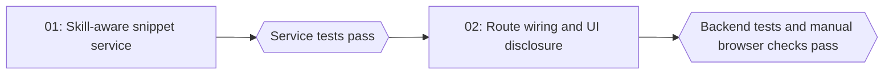

# Workpad: Apply relevant Avatar skills to selected log fragments

Status: open. Proposed on 2026-11-13. Progress is tracked in [PROGRESS.md](PROGRESS.md). Each sub-task is developed and validated on its own before dependents start.

Parent: none — this is a new workpad.

## Background

- The viewer selection is collected in [`static/chatbot/js/features/log-preview.js`](../../../static/chatbot/js/features/log-preview.js) and added to `ChatbotSnippets` as line-numbered rows. The worker enforces a 200-line / 8,000-character limit in [`static/js/tat_log_preview_worker.js`](../../../static/js/tat_log_preview_worker.js).
- [`static/chatbot/js/features/snippets.js`](../../../static/chatbot/js/features/snippets.js) maintains the selected-fragment conversation and posts `{recipient, message, snippet, history}` to `/explain_snippet`.
- [`blueprints/chatbot/chatbot_routes.py`](../../../blueprints/chatbot/chatbot_routes.py) implements `AgentRoutes.explain_snippet`; for Avatar it passes the current configuration agent's skill name, description, keywords, and `expert_rules` to the snippet service.
- [`services/chatbot/snippets.py`](../../../services/chatbot/snippets.py) validates and bounds the fragment, matches skill keywords against selected rows only, and deterministically applies up to three matched skills. Avatar can run explicitly requested, supported fragment tools without fetching other logs; Echo keeps its separate tool-free path.
- The active agent stores profile-loaded skills in `agent.skills`; each skill has a name, description, `keywords`, and `expert_rules`. The regular log filter treats keyword entries as case-insensitive literal substrings unless a TAT rule explicitly requests regex matching.
- Backend coverage is in `tests/` and `unit_tests/`; no JavaScript test harness is present. The snippet service has focused tests in [`tests/test_chatbot_snippets.py`](../../../tests/test_chatbot_snippets.py).

## Cause / Goal

The selected-fragment endpoint is a separate, bounded path from `/chat`. Its initial selector used only skill names/descriptions, even though configured skills already had log-oriented `keywords`; the route did not pass those keywords. This made a short fragment's concrete log signals easy to miss during skill selection.

The goal is to make the Avatar snippet path:

1. Use case-insensitive literal keyword hits in selected log rows as the primary eligibility signal; do not count the filename or user question as log evidence. Restrict matching to the current profile/conversation agent's loaded skills.
2. Deterministically apply up to three matched skills, ranked by matched keyword specificity and count. Apply their `expert_rules` and return matched keywords, applied skill(s), and a concise reason or clear no-match result.
3. Preserve fragment-only safety and evidence rules: selected line numbers remain visible, omitted lines are not inferred, log content is untrusted data, and no whole-log fetch is introduced.
4. Keep Echo's current fragment-only behavior and the existing input limits unchanged.

## Recommendation

Keep selection inside the bounded snippet-analysis service rather than redirecting the fragment into the general agentic `/chat` loop. Match configured keywords deterministically against selected rows and apply the strongest up to three hits without asking the model to accept or reject them. Run explicitly requested, supported tools on the fragment and expose tool status alongside keyword evidence. Echo and the normal chat agent remain isolated.

Avatar fragment analysis supports `lookup_assert_code` using codes found in selected rows and `softAP_supported_channel` using only selected text. Profile-disabled and unsupported tools are reported as unavailable. Each request is limited to 20 tool calls and 10,000 characters of tool output; missing data, errors, and limits are reported. Assert lookup may initialize its existing local reference cache.

Each Avatar answer displays the LLM-reported input, output, and total tokens for that request, including Anthropic cached input tokens. Missing usage is shown as unavailable rather than estimated. Echo does not report token usage.

## Workflow

```mermaid
flowchart LR
    A[Viewer selection] --> B[ChatbotSnippets]
    B --> C[/explain_snippet]
    C --> D[Validate rows, bounds, line refs]
    D --> E[Match keywords in selected rows]
    E --> F[Rank keyword hits and apply top three]
    F --> T[Run supported fragment-only tools]
    T --> G[Avatar explanation with matched expert rules]
    D --> H[Echo fragment-only prompt]
    G --> I[Answer and keyword evidence]
    H --> I
```



## Sub-tasks

| # | Sub-task | Workpad |
|---|---|---|
| 01 | Skill-aware snippet analysis | [01_skill_aware_service.md](01_skill_aware_service.md) |
| 02 | Wire current skills and disclose usage | [02_route_and_ui.md](02_route_and_ui.md) |

## Rules

- Only the current Avatar conversation/profile agent's loaded skills may be offered to the selector; do not silently load a different or global skill set.
- The snippet path remains fragment-only. Do not call `fetch_filtered_logs`, `query_log_detail`, or read the underlying log file. Only explicitly requested, profile-enabled tools with fragment-safe adapters may execute.
- Treat selected log lines as untrusted evidence, not instructions. Preserve original `[L<number>]` references and the omitted-lines marker.
- Keep the existing 200-line, 8,000-character selection limits and Echo behavior unless a separate request changes them.
- Add backend tests for selected-row-only keyword matching, sole/multiple candidates, selected `expert_rules`, no-match behavior, malformed model output, and Echo isolation. Validate UI changes manually in the desktop browser; this repository has no JS test harness.
- Never use real customer logs or skill data as literal fixtures. Use small synthetic rows and synthetic skill definitions.
