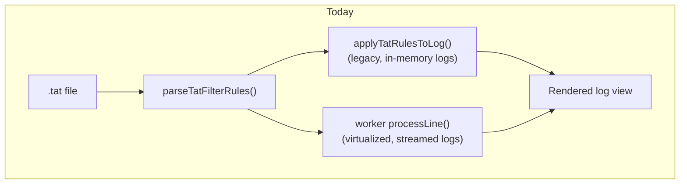
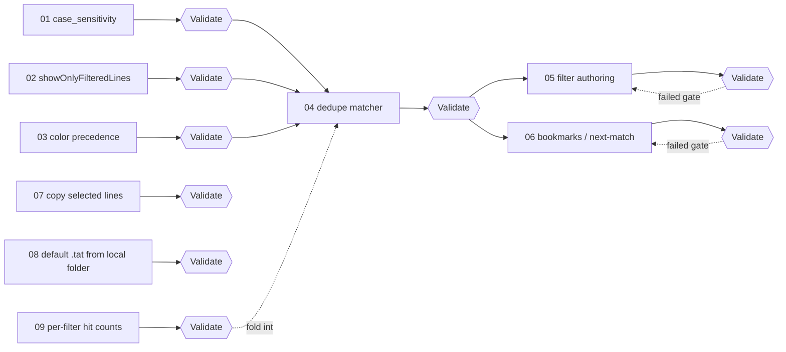

# Workpad: Make the in-chat TAT log viewer behave like TextAnalysisTool.NET

Status: open. Proposed on 2026-11-04. Progress is tracked in [PROGRESS.md](PROGRESS.md). Each
sub-task below is developed and validated on its own before the next one starts.

Parent: none — this is a new workpad.

## Task (from the owner)

The chatbot's log viewer ("advanced mode") already has a `.tat`-filter-driven view beside the
chat. It is not perfect yet: the owner wants it to behave like the real TextAnalysisTool.NET,
co-developed with other engineers, with a shared workpad tracking purpose, features and progress.

## Background

The feature lives entirely on the front end — there is **no Python/backend code to touch** for
any of the sub-tasks below, and consequently **no pytest coverage is possible for them** (this
repo has no JS test harness: no `package.json`, no Jest, nothing under `tests/` exercises
`static/`). Validation is manual, in-browser, against a real `.tat` + log sample.

Two files implement the whole feature and duplicate each other's filter logic:

- [`static/chatbot/js/features/log-preview.js`](../../../static/chatbot/js/features/log-preview.js)
  — the dialog/panel UI, `.tat` parsing (`parseTatFilterRules`), the filter-rule list
  (`renderTatFilterOptions`), and a **legacy non-virtualized** matcher
  (`applyTatRulesToLog` / `renderTatFilteredSections`) used when a result's raw log text is
  already in memory (e.g. "View filtered skill logs").
- [`static/js/tat_log_preview_worker.js`](../../../static/js/tat_log_preview_worker.js) — a Web
  Worker that streams large logs in 1 MB chunks and applies the **same** filter rules
  (`processLine`) for the virtualized "TAT Log Preview" path (used by `startTatLogScan`), so huge
  logs don't block the UI.

`_MLO_Connect_S3S4-ME-WOW-9-MLO-eMLSR.tat` at the repo root is an **untracked**, real `.tat` file
with live filter text (MAC addresses, SSID-shaped strings) pulled from an actual investigation.
**Do not commit it or copy it into a fixture as-is** — treat it the same way customer log content
is treated elsewhere in this repo: build a small synthetic `.tat` fixture with the same filter
*shapes* (plain text, regex, exclude, case-sensitive, no-color) instead, for manual testing and
any future screenshots.

## Cause (verified read-only, 2026-11-04)

Not a single bug — eight concrete gaps against real TextAnalysisTool.NET behavior. The first six
were found by reading `log-preview.js` and `tat_log_preview_worker.js` line by line; the seventh
and eighth were raised directly by the owner and confirmed by the same read:

1. **`case_sensitive` is parsed from nowhere.** `.tat` filters carry a `case_sensitive="n"`
   attribute; `parseTatFilterRules` never reads it. Matching is always lowercase in both
   `applyTatRulesToLog`'s `matches()` and the worker's `processLine`/`matches()`, and regex rules
   always compile with the `i` flag (`new RegExp(rule.text, 'i')` in both files).
2. **`showOnlyFilteredLines` (a root-level `<TextAnalysisTool.NET>` attribute) is ignored.** The
   sample `.tat` sets it `True`; the code always behaves as if it were `True` — there is no path
   that shows all lines with matches merely highlighted in place. (Coded 2026-11-09, together with a
   Ctrl+H runtime toggle on the same engine — see sub-task 02.)
3. **First-matching-filter wins a line's color, not the last.** `includeRules.find(...)`
   (`log-preview.js:395`, worker line 88) takes the first enabled include rule in file order.
   TextAnalysisTool.NET applies filters in order and a later filter overrides an earlier match on
   the same line.
4. **The matching logic is implemented twice** (`applyTatRulesToLog` vs. `processLine`), so any
   fix — including #1–#3 — has to land in both places or they silently drift apart again.
5. **No in-app filter authoring.** A `.tat` can only be loaded from disk; there is no way to
   add/edit/reorder/delete a filter or save the set back out.
6. **No bookmarks / next-match navigation** (an F3-style jump between hits of one filter).
7. **No way to copy selected lines to the clipboard.** Selection only feeds "Add to question";
   there's no clipboard export, and in the virtualized view, off-screen selected rows don't exist
   in the DOM, so native browser copy can't reach them even as a workaround. (Done 2026-11-10 — see
   sub-task 07.)
8. **No default `.tat` filter.** A `.tat` must be picked via "Load .tat" every time the viewer
   opens; there is no way to auto-load a default filter set from a fixed local folder for a user
   who always analyzes with the same filters.
9. **No per-filter hit counts.** The filter list shows mod + pattern only; there is no way to see
   how many log lines a given keyword/regex matches, independent of whether it's enabled.

Checked but not a gap: enable/disable of an existing filter already works correctly today
(`renderTatFilterOptions`'s checkbox toggles `rule.enabled` and both matchers already respect it).

## Recommendation

Fix correctness first while the duplication still exists (small, independent, easy to validate
one at a time), then collapse the two matchers into one shared implementation, then build the two
new UI capabilities on top of the now-single implementation. Nothing here is reused from another
part of this codebase — it is this feature's own logic end to end.

## Workflow

## Sub-tasks

| # | Sub-task | Workpad |
|---|---|---|
| 01 | Honor `case_sensitive` | [01_case_sensitivity.md](01_case_sensitivity.md) |
| 02 | Honor `showOnlyFilteredLines` | [02_show_only_filtered_lines.md](02_show_only_filtered_lines.md) |
| 03 | Last-match color precedence | [03_filter_color_precedence.md](03_filter_color_precedence.md) |
| 04 | One shared matcher (dedupe) | [04_dedupe_matching_logic.md](04_dedupe_matching_logic.md) |
| 05 | In-app filter authoring | [05_in_app_filter_authoring.md](05_in_app_filter_authoring.md) |
| 06 | Bookmarks / next-match nav | [06_bookmarks_next_match.md](06_bookmarks_next_match.md) |
| 07 | Copy selected lines | [07_copy_selected_lines.md](07_copy_selected_lines.md) |
| 08 | Default .tat from local folder | [08_default_tat_from_local_folder.md](08_default_tat_from_local_folder.md) |
| 09 | Per-filter hit counts | [09_filter_hit_counts.md](09_filter_hit_counts.md) |

## Rules

- No backend/Python is involved in this feature; do not add Flask routes or services for it
  unless a sub-task explicitly needs server-side help. **Exception: sub-task 08** needs a new Flask
  route (`default_tat_filter`) because only the server can read a fixed local filesystem path —
  see that sub-task's doc for the exact file/route to touch.
- No JS test harness exists in this repo. Each sub-task's "Validate" section is a manual,
  in-browser checklist — do not claim `pytest` coverage for front-end changes that have none.
- Never commit `_MLO_Connect_S3S4-ME-WOW-9-MLO-eMLSR.tat` or any other real `.tat`/log pulled from
  an investigation. Build small synthetic fixtures instead.
- Fix #1–#3 once in each of the two existing matchers (`log-preview.js` and the worker) — do not
  wait for the dedupe sub-task to fix a correctness bug, but do design the fix so sub-task 04 can
  delete one of the two copies cleanly afterward.
- A sub-task is done when its "Validate" checklist holds and the commit message summarizes what
  was checked (sample `.tat`, sample log, before/after behavior).
- When the whole workpad is finished: Status → fixed, `git mv docs/workpad/tat_log_viewer`
  to `docs/workpad/finished/`.
